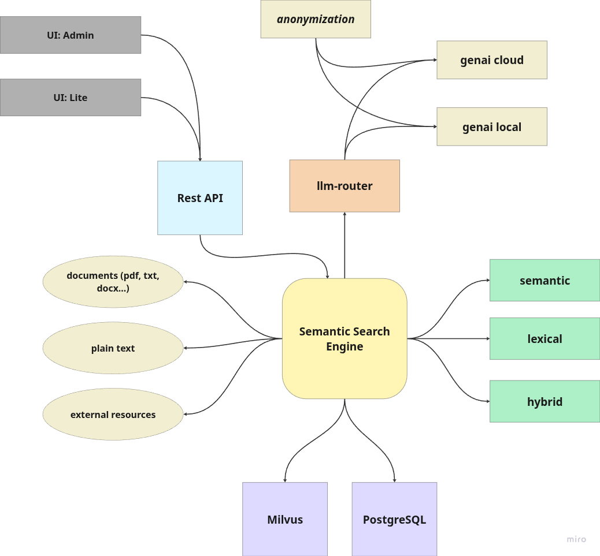

# System and Hardware Requirements — Semantic Search Engine (`radlab-dev-group/semantic-search-engine`)

This document defines the software (system) and hardware requirements for deploying and operating the **Semantic Search Engine** platform (architecture: Django REST API, PostgreSQL, Milvus + etcd + MinIO, optional Celery + RabbitMQ, Nginx, the `sse_models` model service with PyTorch / Transformers / Sentence-Transformers, and optional local LLMs).

---

## 1. System Requirements (Software)

Software requirements are shared across all tiers (minimal, optimal, and recommended), differing primarily in deployment mode (local development vs. Docker Compose / production):

| Component | Required Version | Notes |
|---|---|---|
| **Operating System** | Linux (Ubuntu 22.04/24.04 LTS, Debian 12, RHEL 9+) | Linux x86_64 is recommended. Local development also works on macOS / Windows (WSL2). |
| **Python** | **3.11+** | Required to run `sse_api`, `sse_models`, `sse_tools`, and `sse_lib`. |
| **Docker & Docker Compose** | Docker 24+ / Compose v2+ | Recommended for running the full stack (`docker-compose.yml`: API, PostgreSQL, Milvus, etcd, MinIO, Nginx, RabbitMQ, Celery). |
| **PostgreSQL** | **12+** (Compose: `postgres:latest`) | Relational store for metadata, documents, users, collections, and full-text search (FTS). |
| **Milvus** | **2.3+** (Compose: `v3.0.3`) | Vector database (requires `etcd` and `MinIO`, or standalone mode with embedded etcd). |
| **Nginx** | 1.24+ | Reverse proxy with TLS termination for production environments. |
| **RabbitMQ + Celery** | RabbitMQ 3.13+, Celery 5.3+ | Optional (`indexing` profile), required for asynchronous indexing of large datasets (`ENV_USE_CELERY=1`). |
| **CUDA / NVIDIA Drivers** | **CUDA 11.8 / 12.x** (optional) | Required only for GPU acceleration of embeddings, rerankers, and local LLMs. |

---

## 2. Hardware Requirements — Tiers

Hardware sizing depends on the number of indexed documents, the size of embedding/reranking models (e.g., `bge-m3`, `e5-large`, `polish-denoiser-t5-base`), and whether generative models (LLMs for RAG) are hosted locally or accessed via external APIs (e.g., OpenAI / LLMRouter).

### Tier 1: Minimal (Development / PoC / Small Datasets)
Intended for local testing, software development, and indexing small datasets (up to ~10k–50k chunks) using lightweight CPU models or external LLM APIs.

* **CPU:** 4 cores (x86_64 with AVX2 support)
* **RAM:** **16 GB** (8 GB minimum for API + PostgreSQL without local Milvus, but the full Docker stack with Milvus + etcd + MinIO + PyTorch models requires at least 16 GB)
* **GPU:** None (CPU inference; slower indexing and reranking)
* **Storage (SSD):** **40 GB free space** (Docker images, HuggingFace model weights, PostgreSQL and Milvus data)
* **Network:** 100 Mbps

---

### Tier 2: Optimal (Small/Medium Production / Team)
Intended for stable production workloads for a team or mid-sized organization (50k to ~1M chunks), with an indexing queue (Celery + RabbitMQ), dedicated model service (`sse_models`), and GPU acceleration for embeddings and reranking.

* **CPU:** 8–16 cores (e.g., AMD EPYC / Intel Xeon / Ryzen)
* **RAM:** **32 GB – 64 GB** (Milvus keeps vector indexes in RAM; higher memory prevents OOM when running the API, Celery worker, and models concurrently)
* **GPU:** **NVIDIA GPU with 12–16 GB VRAM** (e.g., RTX 4060 Ti 16GB, RTX 4080, NVIDIA L4 24GB, or T4 16GB) — sufficient for fast embedding generation, cross-encoder reranking, and optionally small 4-bit quantized LLMs (7B–8B)
* **Storage (NVMe SSD):** **150 – 250 GB NVMe** (fast I/O for Milvus, PostgreSQL, and model cache)
* **Network:** 1 Gbps

---

### Tier 3: Recommended (High-Load Production / Full Local RAG)
Intended for enterprise deployments with high concurrency, large data volumes (1M+ chunks), and running local LLMs for RAG without relying on external APIs.

* **CPU:** 16–32+ cores
* **RAM:** **64 GB – 128 GB+** (provides ample buffer for Milvus HNSW/IVF indexes, PostgreSQL cache, and multiple Gunicorn/Celery workers)
* **GPU:** **NVIDIA GPU with 24 GB – 48+ GB VRAM** (e.g., NVIDIA L40S 48GB, A100 40/80GB, RTX 4090 24GB, or multi-GPU setup) — enables keeping large embedding models, rerankers, and a full RAG LLM in VRAM simultaneously
* **Storage (NVMe SSD):** **500 GB – 1 TB+ NVMe (RAID / high-IOPS volume)** with separate volumes for logs, PostgreSQL/Milvus snapshots, and model storage
* **Network:** 10 Gbps (especially in distributed architectures with dedicated Milvus / GPU nodes)

---

## 3. Comparison Table

| Parameter | Minimal (Dev / PoC) | Optimal (Production) | Recommended (Enterprise / High-Load) |
|---|---|---|---|
| **CPU** | 4 vCPU / cores | 8–16 vCPU / cores | 16–32+ vCPU / cores |
| **RAM** | 16 GB | 32–64 GB | 64–128+ GB |
| **GPU (VRAM)** | None (CPU) | 12–16 GB VRAM (e.g., T4 / L4 / RTX 4060 Ti) | 24–48+ GB VRAM (e.g., L40S / A100 / RTX 4090) |
| **Storage** | 40 GB SSD | 150–250 GB NVMe SSD | 500 GB – 1 TB+ NVMe SSD |
| **Queue (Celery/RabbitMQ)** | Optional (disabled) | Enabled (`ENV_USE_CELERY=1`) | Enabled (multiple workers) |
| **Data Scale** | up to ~50k chunks | 50k – 1M chunks | 1M+ chunks |

---

