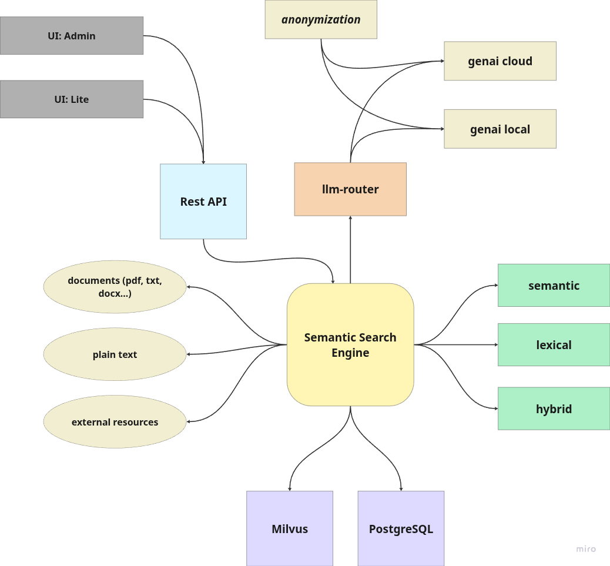

# Wymagania systemowo-sprzętowe — Semantic Search Engine (`radlab-dev-group/semantic-search-engine`)

Dokument określa wymagania programowe (systemowe) oraz sprzętowe dla uruchomienia i utrzymania platformy **Semantic Search Engine** (architektura: Django REST API, PostgreSQL, Milvus + etcd + MinIO, opcjonalnie Celery + RabbitMQ, Nginx, usługa modeli `sse_models` z PyTorch / Transformers / Sentence-Transformers oraz opcjonalne lokalne modele LLM).

---

## 1. Wymagania systemowe (oprogramowanie)

Wymagania programowe są wspólne dla wszystkich wariantów (minimalnego, optymalnego i zalecanego), z różnicami w sposobie wdrożenia (lokalnie vs Docker Compose / produkcja):

| Komponent | Wymagana wersja | Uwagi |
|---|---|---|
| **System operacyjny** | Linux (Ubuntu 22.04/24.04 LTS, Debian 12, RHEL 9+) | Zalecany system Linux x86_64. Środowisko deweloperskie działa również na macOS / Windows (WSL2). |
| **Python** | **3.11+** | Wymagany do uruchomienia `sse_api`, `sse_models`, `sse_tools` oraz `sse_lib`. |
| **Docker & Docker Compose** | Docker 24+ / Compose v2+ | Zalecane do uruchomienia całego stosu (`docker-compose.yml`: API, PostgreSQL, Milvus, etcd, MinIO, Nginx, RabbitMQ, Celery). |
| **PostgreSQL** | **12+** (w Compose: `postgres:latest`) | Baza relacyjna dla metadanych, dokumentów, użytkowników, kolekcji oraz wyszukiwania pełnotekstowego (FTS). |
| **Milvus** | **2.3+** (w Compose: `v3.0.3`) | Baza wektorowa (wymaga `etcd` i `MinIO` lub trybu standalone z wbudowanym etcd). |
| **Nginx** | 1.24+ | Reverse proxy z obsługą TLS w środowisku produkcyjnym. |
| **RabbitMQ + Celery** | RabbitMQ 3.13+, Celery 5.3+ | Opcjonalne (profil `indexing`), wymagane przy asynchronicznym indeksowaniu dużych zbiorów (`ENV_USE_CELERY=1`). |
| **CUDA / Sterowniki NVIDIA** | **CUDA 11.8 / 12.x** (opcjonalnie) | Wymagane tylko przy akceleracji GPU dla embeddingów, rerankerów i lokalnych modeli LLM. |

---

## 2. Wymagania sprzętowe — zestawienie wariantów

Dobór sprzętu zależy od liczby indeksowanych dokumentów, rozmiaru modeli embeddingujących/rerankujących (np. `bge-m3`, `e5-large`, `polish-denoiser-t5-base`) oraz tego, czy modele generatywne (LLM dla RAG) działają lokalnie, czy przez zewnętrzne API (np. OpenAI / LLMRouter).

### Wariant 1: Wersja minimalna (Środowisko deweloperskie / PoC / małe zbiory)
Przeznaczona do testów lokalnych, rozwoju oprogramowania i indeksowania małych zbiorów danych (do ok. 10–50 tys. fragmentów/chunków) przy użyciu lekkich modeli na CPU lub zewnętrznego API LLM.

* **CPU:** 4 rdzenie (x86_64, obsługa AVX2)
* **RAM:** **16 GB** (minimum 8 GB dla samego API + PostgreSQL bez lokalnego Milvusa, jednak pełny stos Docker z Milvus + etcd + MinIO + modelami PyTorch wymaga min. 16 GB)
* **GPU:** Brak (obliczenia na CPU; wolniejsze indeksowanie i reranking)
* **Dysk (SSD):** **40 GB wolnego miejsca** (obrazy Docker, wagi modeli z HuggingFace, baza PostgreSQL i Milvus)
* **Sieć:** 100 Mbps

---

### Wariant 2: Wersja optymalna (Mała/średnia produkcja / Zespół)
Przeznaczona do stabilnej pracy produkcyjnej dla zespołu lub średniej organizacji (od 50 tys. do ok. 1 mln fragmentów), z obsługą kolejki indeksowania (Celery + RabbitMQ), wydzieloną usługą modeli (`sse_models`) oraz akceleracją GPU dla embeddingów i rerankingu.

* **CPU:** 8–16 rdzeni (np. AMD EPYC / Intel Xeon / Ryzen)
* **RAM:** **32 GB – 64 GB** (Milvus utrzymuje indeksy wektorowe w pamięci RAM; większa ilość RAM zapobiega OOM przy jednoczesnej pracy API, workera Celery i modeli)
* **GPU:** **NVIDIA GPU z 12–16 GB VRAM** (np. RTX 4060 Ti 16GB, RTX 4080, NVIDIA L4 24GB lub T4 16GB) — wystarczające do szybkiego działania modeli embeddingujących, cross-encoderów (reranker) oraz ewentualnie małych modeli LLM (7B–8B w kwantyzacji 4-bit)
* **Dysk (NVMe SSD):** **150 – 250 GB NVMe** (szybki odczyt/zapis dla Milvus, PostgreSQL i cache modeli)
* **Sieć:** 1 Gbps

---

### Wariant 3: Wersja zalecana (Środowisko produkcyjne High-Load / Pełny RAG lokalny)
Przeznaczona do wdrożeń korporacyjnych o wysokim obciążeniu, dużych wolumenów danych (powyżej 1 mln fragmentów), wielu równoczesnych zapytań użytkowników oraz uruchamiania lokalnych modeli LLM (RAG) bez polegania na zewnętrznych API.

* **CPU:** 16–32+ rdzenie
* **RAM:** **64 GB – 128 GB+** (zapewnia duży bufor dla indeksów HNSW/IVF w Milvus, cache PostgreSQL oraz wielu workerów Gunicorn/Celery)
* **GPU:** **NVIDIA GPU z 24 GB – 48+ GB VRAM** (np. NVIDIA L40S 48GB, A100 40/80GB, RTX 4090 24GB lub konfiguracja multi-GPU) — umożliwia jednoczesne utrzymanie w pamięci VRAM dużych modeli embeddingujących, rerankera oraz pełnego modelu LLM do generowania odpowiedzi RAG
* **Dysk (NVMe SSD):** **500 GB – 1 TB+ NVMe (RAID / szybki wolumen)** z osobnym wolumenem na logi, snapshoty PostgreSQL/Milvus oraz repozytorium modeli
* **Sieć:** 10 Gbps (szczególnie przy rozproszonej architekturze z osobnym klastrem Milvus / GPU)

---

## 3. Tabela porównawcza

| Parametr | Wersja minimalna (Dev / PoC) | Wersja optymalna (Produkcja) | Wersja zalecana (Enterprise / High-Load) |
|---|---|---|---|
| **CPU** | 4 vCPU / rdzenie | 8–16 vCPU / rdzeni | 16–32+ vCPU / rdzeni |
| **RAM** | 16 GB | 32–64 GB | 64–128+ GB |
| **GPU (VRAM)** | Brak (CPU) | 12–16 GB VRAM (np. T4 / L4 / RTX 4060 Ti) | 24–48+ GB VRAM (np. L40S / A100 / RTX 4090) |
| **Dysk** | 40 GB SSD | 150–250 GB NVMe SSD | 500 GB – 1 TB+ NVMe SSD |
| **Kolejka (Celery/RabbitMQ)** | Opcjonalna (wyłączona) | Włączona (`ENV_USE_CELERY=1`) | Włączona (wiele workerów) |
| **Skala danych** | do ~50 tys. chunków | 50 tys. – 1 mln chunków | 1 mln+ chunków |

---

